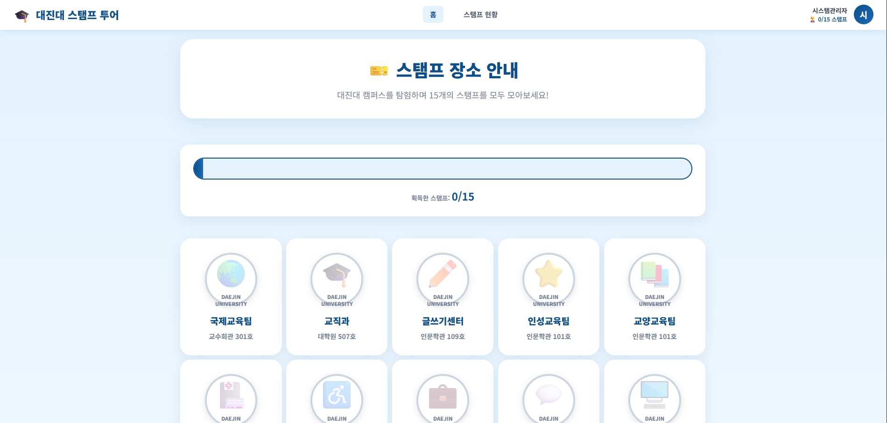
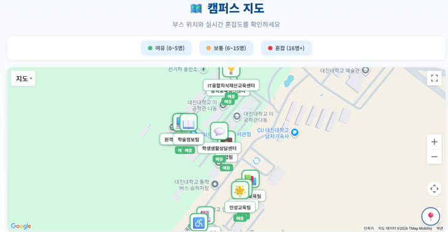
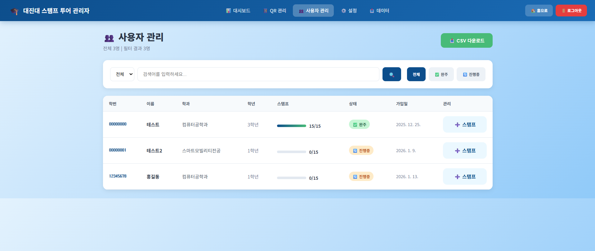
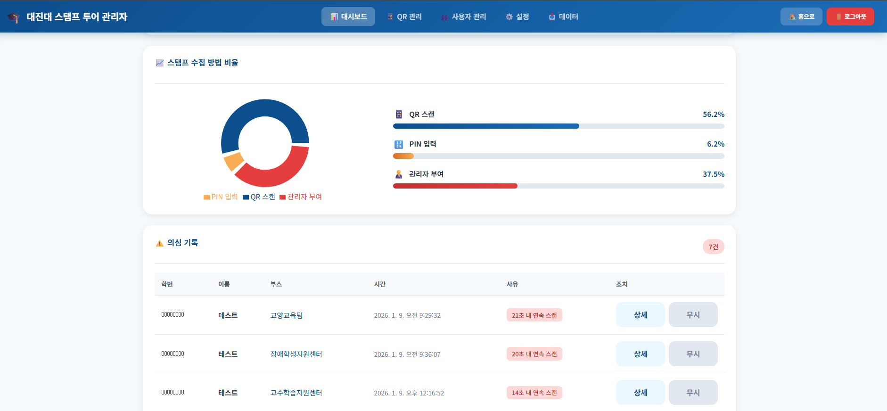

# 🗺️ DjuStamp - 대진대학교 QR 스탬프 투어

> 대진대학교 비교과 프로그램을 위한 QR 기반 스탬프 투어 서비스  
> GPS 위치 검증 + 실시간 혼잡도 모니터링 + 관리자 대시보드를 갖춘 풀스택 프로젝트


---


---

## 📸 서비스 화면

> 🎬 데모 영상  
> [유튜브 영상 보기](https://youtu.be/vDVEC6lWOSE)

**스탬프 보드 (PC버전)**


**혼잡도 지도**


**관리자 대시보드**


**부정행위 의심 명단**


---


## 🧭 프로젝트 소개

대진대학교 비교과 프로그램은 종이 스탬프 방식으로 운영되고 있었습니다.
학생들은 책자를 들고 다녀야 했고, 운영팀은 수천 장의 종이를 수기로 대조해
완주자를 정리해야 했습니다. 실시간으로 부스 혼잡도를 파악할 방법도 없었습니다.

이 문제를 해결하기 위해 QR 코드 기반 스탬프 투어 서비스를 직접 기획하고
개발했습니다. **GPS 위치 검증**, **이중 부정행위 방지**, **실시간 혼잡도 모니터링**,
**관리자 대시보드**까지 직접 설계했으며, 학교 측에 도입 제안서를 제출하고
**실제 배포 및 도메인 운영(djustamp.com)까지 완료**한 프로젝트입니다.
---

## ✨ 주요 기능

### 👤 사용자 (학생)

| 기능 | 설명 |
|------|------|
| QR 스탬프 인증 | 부스 QR 코드 스캔 한 번으로 스탬프 수집 완료 |
| PIN 번호 대체 인증 | QR 훼손 또는 스마트폰 오류 시 PIN 번호로 즉시 대체 인증 |
| 실시간 스탬프 보드 | 현재 수집 현황 및 완주까지 남은 개수 실시간 확인 |
| 실시간 혼잡도 지도 | 카카오맵 기반 부스 위치 + 혼잡도 표시로 줄 긴 곳 회피 가능 |
| 마이페이지 | 수집 현황 및 히스토리 조회 |

### 🛠️ 관리자

| 기능 | 설명 |
|------|------|
| 이중 부정행위 검증 | GPS 반경 검증 + 이동 속도 기반 순간이동 감지를 동시에 적용 |
| 부정행위 의심 명단 | 의심 기록과 사유(위치 이탈 / 속도 초과 등)를 목록으로 확인 가능 |
| 통계 대시보드 | 총 참여자 수, 완주자 수 등 핵심 지표 실시간 조회 |
| 원 클릭 데이터 추출 | 완주자 명단 및 부스별 통계를 CSV로 즉시 다운로드 |
| QR 코드 관리 | 부스 생성·수정·삭제, QR 코드 직접 생성 및 PNG 다운로드 |
| GPS 검증 토글 | GPS 검증 활성화 여부를 관리자 페이지에서 실시간 on/off |

---

## 🛠️ 기술 스택

| 구분 | 기술 |
|------|------|
| **Frontend** | React 18, Vite |
| **Backend** | FastAPI, Python |
| **Database** | PostgreSQL (AWS RDS) |
| **Infra** | AWS EC2, Nginx, Let's Encrypt (SSL) |
| **지도** | Kakao Maps API |
| **인증** | JWT |
| **도메인** | djustamp.com |

---

## 🏗️ 시스템 아키텍처

```
사용자 브라우저
    │
    ▼
[React (Vite)]  ─── HTTPS ───▶  [Nginx (EC2)]
                                      │
                                      ▼
                               [FastAPI (uvicorn)]
                                 ┌────┴────┐
                                 ▼         ▼
                          [PostgreSQL]  [Kakao API]
                           (AWS RDS)
```

---

## 📁 프로젝트 구조

```
djustamp/
├── frontend/
│   ├── src/
│   │   ├── pages/          # 페이지 컴포넌트 (Home, MyPage, Admin 등)
│   │   ├── components/     # 공통 컴포넌트
│   │   └── api/            # API 호출 함수
│   └── vite.config.js
│
└── backend/
    ├── routers/
    │   ├── stamps.py       # 스탬프 수집 로직 (부정행위 방지 포함)
    │   ├── booths.py       # 부스 CRUD + QR 코드 생성
    │   ├── users.py        # 사용자 인증 (JWT)
    │   └── admin.py        # 관리자 기능 (통계, CSV 추출)
    ├── models.py
    ├── database.py
    └── main.py
```

---

## ⚙️ 로컬 실행 방법

### 사전 요구사항
- Python 3.10+
- Node.js 18+
- PostgreSQL

### 백엔드

```bash
cd backend
python -m venv venv
source venv/bin/activate  # Windows: venv\Scripts\activate
pip install -r requirements.txt

cp .env.example .env
# DATABASE_URL, SECRET_KEY 등 설정

uvicorn main:app --reload
```

### 프론트엔드

```bash
cd frontend
npm install

cp .env.example .env
# VITE_API_URL 설정

npm run dev
```

---

## 🌐 배포 환경

| 항목 | 내용 |
|------|------|
| 서버 | AWS EC2 (Ubuntu) |
| 웹서버 | Nginx (리버스 프록시) |
| SSL | Let's Encrypt |
| DB | AWS RDS PostgreSQL |
| 도메인 | djustamp.com (현재 서비스 종료) |

> **Note:** 비용 문제로 2026년 5월 서버를 내렸습니다.  
> 코드는 포트폴리오 및 참고 목적으로 공개되어 있습니다.

---

## 🔍 기술적 도전 & 해결 과정

### 1. 이중 부정행위 방지 설계
단순 QR 중복 방지를 넘어, **GPS 반경 검증**과 **이동 속도 기반 순간이동 감지**를 동시에 적용했습니다. 의심 기록은 사유와 함께 관리자 명단에 남겨 사후 검토도 가능하게 설계했습니다.

### 2. 실시간 혼잡도 모니터링
카카오맵과 연동해 부스별 방문자 분포를 실시간으로 시각화했습니다. 학생은 줄 긴 부스를 피할 수 있고, 관리자는 인파를 즉시 파악할 수 있습니다.

### 3. CSV 원 클릭 추출
완주자 명단을 마일리지 입력용으로 즉시 내보낼 수 있도록 관리자 대시보드에 CSV 다운로드 기능을 구현했습니다. 기존 수기 정리 방식 대비 운영 효율을 크게 높인 기능입니다.

### 4. EC2 직접 배포
Nginx 리버스 프록시 설정, Let's Encrypt SSL 발급, 프로세스 관리까지 터미널에서 직접 구성하며 서버 인프라를 이해했습니다.

---

## 📊 기존 방식 vs DjuStamp

| 구분 | 기존 방식 (종이) | DjuStamp (디지털) |
|------|-----------------|-------------------|
| 제작 비용 | 인쇄비 지속 발생 | 초기 구축 후 거의 없음 |
| 데이터 정리 | 며칠간 수기 입력 | 종료 즉시 CSV 다운로드 |
| 이용 편의 | 책자 지참 필수, 분실 위험 | 스마트폰 하나로 해결 |
| 부정행위 | 대리 도장 가능 | GPS + 속도 이중 검증 |
| 실시간 관리 | 불가 | 혼잡도 지도로 즉시 파악 |

---

## 📝 회고

학교 측에 직접 도입 제안서를 작성해 제출했지만, 행정 프로세스상 거절당했습니다. 기능의 완성도보다 기관 도입 과정의 복잡함을 실감한 경험이었고, 오히려 **기획-설계-개발-배포-제안까지 혼자 완주한 경험** 자체가 더 큰 자산이 됐습니다.

- 블로그- 실패한 이유 분석 글: [ByteScholar](https://bytescholar.tistory.com/entry/QR-%EC%8A%A4%ED%83%AC%ED%94%84-%ED%88%AC%EC%96%B4-%EC%A0%9C%EC%95%88%EC%84%9C%EA%B0%80-%EB%B0%9B%EC%95%84%EB%93%A4%EC%97%AC%EC%A7%80%EC%A7%80-%EC%95%8A%EC%9D%80-%EC%9D%B4%EC%9C%A0)

---

## 📄 라이선스

MIT License

---

## 👨‍💻 개발자

**박민석** · [@minseok852](https://github.com/minseok852)  
email : min85296@gmail.com  
대진대학교 컴퓨터공학과